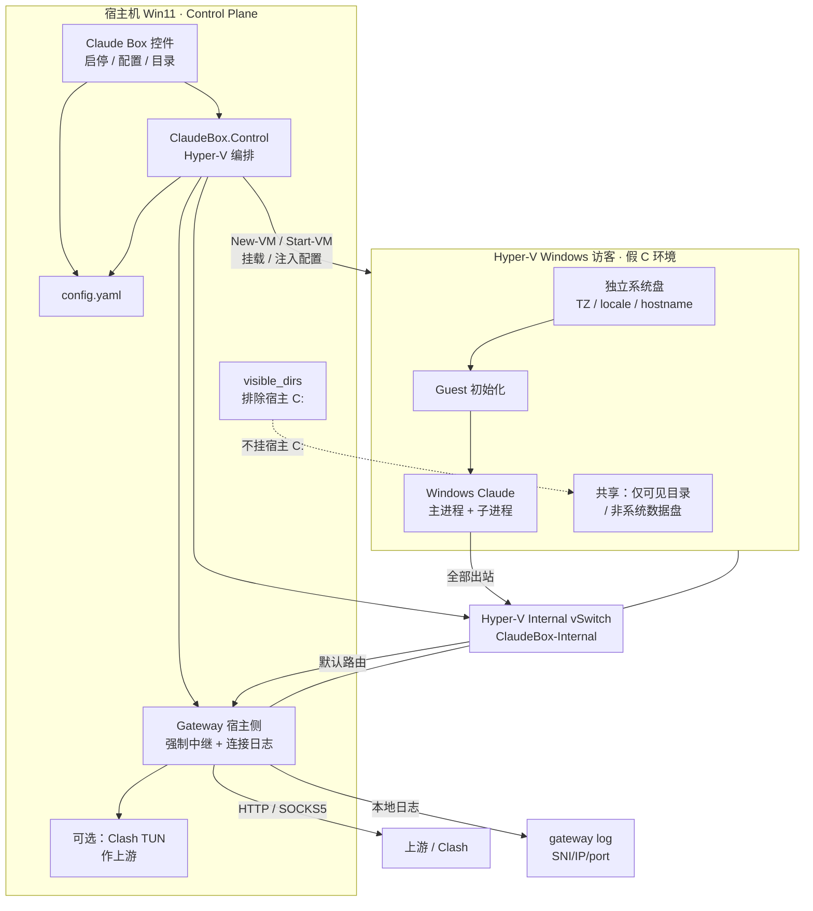

# Claude Box · 架构方案 v0

- **日期**：2026-10-31（Asia/Tokyo）；**MVP 决策修订**同日
- **对应范围**：[SCOPE.md](../SCOPE.md) v0.1（主路径：Hyper-V Windows 访客 + Windows Claude）
- **依赖调研**：[research-v1-runtime.md](./research-v1-runtime.md)（尤其 §2.6 Hyper-V Win、§3 唯一网关）
- **性质**：产品架构与仓库骨架约定；标「待验证」处禁止当定论
- **不做**：本文件不声称已在 Hyper-V 上跑通；不 push 远程
- **状态**：**MVP in progress · M4（最小控件 UI）骨架已落地；真 Hyper-V / WinForms / vmconnect 联调待验证**

---

## 0. MVP 已定决策（和零确认 · 先构建 MVP）

| # | 决策 | 说明 |
|---|---|---|
| D1 | **整访客隔离** | Hyper-V Windows 访客专给 Claude Box；Claude Desktop **主进程 + 全部子进程**只在访客内跑，不进宿主机进程空间 |
| D2 | **Windows Claude** | exe/MSIX；保留 Computer use；不用 Linux Claude |
| D3 | **透窗** | 用户在宿主机管理员会话里经 Enhanced Session / `vmconnect` 看见并操作访客内 Claude UI |
| D4 | **挂盘默认排除宿主 `C:`** | 不把宿主机系统盘挂进访客；可挂非系统数据盘 / `visible_dirs` 选中目录 |
| D5 | **虚假系统环境** | 访客自有系统盘（独立 Windows）；控件写入独立 TZ / locale / hostname 等，语义上是「假 C 环境」——不是把宿主 `C:` 改名伪装 |
| D6 | **唯一网关 + 可接 Clash TUN** | 访客出站硬强制经盒子网关；上游 HTTP/SOCKS5 常指向宿主机 Clash（用户可开 TUN）；网关再转上游 |
| D7 | **网关连接日志** | 记录域名/SNI、目标 IP、端口、是否经上游等，供事后优化遥测拦截；**仅本地**、可开关；不做默认 TLS 解密 |
| D8 | **验收目标** | 直连公网失败；**大幅降低**环境遥测穿透（**非**绝对零） |

---

## 1. 目标与非目标

### 1.1 目标（对齐 SCOPE + MVP）

| # | 目标 |
|---|---|
| T1 | 在 **隔离的 Windows 访客**里跑 **Windows Claude Desktop**（exe/MSIX），主进程+子进程均在访客内 |
| T2 | **原生 GUI**：Enhanced Session / 访客桌面窗口透出到宿主机 |
| T3 | **唯一网关硬强制**：出站不能直连绕过；上游 HTTP CONNECT / SOCKS5（可接宿主 Clash） |
| T4 | **目录可见性**：默认只挂 `visible_dirs`；**拒绝默认挂宿主 `C:`**；可挂非系统数据盘 |
| T5 | **假环境 / 反遥测**：访客独立 TZ、locale、hostname；网关日志 + 可拦分析域；效果「大幅降低」非绝对 |
| T6 | **独立控件（MVP）**：配网关与日志、选可见目录（排除 C:）、启停实例并透窗 |

### 1.2 非目标（MVP 不做）

| # | 非目标 |
|---|---|
| N1 | 多账号一键切换 |
| N2 | Linux 宿主机一等支持 |
| N3 | Web 远程桌面作主 UX |
| N4 | 自建 Hypervisor / OCI 运行时（借 Hyper-V） |
| N5 | WSL2 / Docker / Linux Claude 作主路径 |
| N6 | Windows Sandbox 作产品运行时（仅冒烟） |
| N7 | macOS 一等实现（次优先，另议） |
| N8 | 保证「挂宿主系统盘仍藏环境」；默认排除宿主 `C:` |
| N9 | 默认 TLS 中间人解密遥测正文 |
| N10 | 数学意义上的「零遥测穿透」承诺 |

---

## 2. 逻辑架构



### 数据流（出站）

1. Claude / 访客进程发起 TCP（及 DNS，策略见 §4）
2. 访客默认路由指向 Internal 网上的网关地址
3. 网关做强制中继 → 转发到控件配置的上游（常为宿主 Clash 的 mixed/HTTP/SOCKS 口；宿主可另开 TUN）
4. 网关按开关写**连接日志**（SNI/域名、IP、端口、上游是否成功）
5. **验收**：关掉上游或误配时，访客内直连公网 **必须失败**

---

## 3. 组件职责

### 3.1 Control Plane（宿主机）· `src/ClaudeBox.Control`

| 职责 | 说明 |
|---|---|
| 读/写配置 | 加载 `config.yaml`；**M4 `Save-ClaudeBoxConfig`** 写回（最小字段抽取读 + 整文件写） |
| Hyper-V 生命周期 | 检查功能、Internal 交换机、**New-ClaudeBoxVM**（Gen2）、启停、销毁 |
| 挂载编排 | `visible_dirs`；**`exclude_host_system_drive` 默认 true** → 拒绝把宿主 `C:\` 当可见根挂入 |
| 网关编排 | 启动/停止宿主侧网关；应用上游与**日志开关/路径** |
| 注入假环境 | 把 `identity` / `guest.fake_env` 交给 Guest 初始化 |
| 透窗 | Enhanced Session / `Connect-ClaudeBoxVM` → `vmconnect`（体验 **待验证**） |

**边界**：不实现透明代理协议栈本身；不在 Control 里装 Claude。

### 3.2 Gateway · `src/ClaudeBox.Gateway`

| 职责 | 说明 |
|---|---|
| 上游适配 | `gateway.http` / `gateway.socks5`；文档说明如何指到 **Clash**（含宿主 TUN 场景） |
| 强制策略 | 路由/防火墙/中继模板；二进制选型 **待验证** |
| **连接日志** | `gateway.logging.enabled` / `path` / 字段约定；本地、可开关 |
| 健康检查钩子 | 直连失败 / 代理出口 IP |
| DNS/UDP 策略 | 见 §4 |

**Clash TUN 上游说明**：

- 访客 **不** 直接进 Clash TUN；访客只认盒子 Internal 网关。
- 盒子网关上游填 Clash 的 **HTTP/SOCKS 监听**（如 `127.0.0.1:7890`）。宿主机若开 Clash TUN，是宿主侧再路由，与访客隔离互补，不是替代盒子强制网关。
- 切勿给访客挂 External/Default Switch「抄近路」进 TUN，否则唯一网关语义失效。

### 3.3 Guest Agent · `src/ClaudeBox.Guest`

| 职责 | 说明 |
|---|---|
| **假环境步骤** | hostname、时区、locale、机器名；清单见 §6 |
| 网络强制（访客内） | 系统代理 + 硬强制；禁旁路 **待验证** |
| 安装 Claude | 引导官方 Windows Claude；安装包不进仓库 |
| 目录挂载点 | 约定盘符；只反映可见目录 / 非系统数据盘 |
| 健康脚本 | 伪装字段、代理、直连失败 |

### 3.4 Config · `config/`

`config/schema/claude-box.schema.json` + `config/config.example.yaml`（字段见 §7）。

---

## 4. 网络强制方案

### 4.1 拓扑

```
[访客 NIC] ── Internal vSwitch "ClaudeBox-Internal" ── [网关 NIC / 宿主 vEthernet]
     │                                                        │
     │  默认网关 = 网关地址（如 192.168.87.1）                    │ 上游 HTTP/SOCKS5
     │  无 External 直连公网                                    ▼
     │                                              [Clash 等用户代理 / 再出站]
     │                                              [可选写本地连接日志]
```

- 访客 **只** 接 Internal 交换机。
- 宿主机为 Internal 网设静态 IP 并跑代理入口。
- **不要**给访客开可直连的 Default NAT 而不经盒子网关。

### 4.2 代理协议与上游

| 配置 | 用途 |
|---|---|
| `gateway.http` | HTTP CONNECT 上游（常为 Clash HTTP 口） |
| `gateway.socks5` | SOCKS5 上游 |
| `gateway.primary` | 双配时优先 |
| `gateway.upstream_notes` | 人类可读：如「指向本机 Clash」 |

MVP：**http 与 socks5 至少一个非空**。

### 4.3 网关连接日志（MVP）

| 项 | 约定 |
|---|---|
| 开关 | `gateway.logging.enabled`（默认 `true` 便于调遥测；可关） |
| 路径 | `gateway.logging.path`（默认宿主本地，如 `%LOCALAPPDATA%\ClaudeBox\logs\gateway.jsonl`） |
| 字段（建议） | `ts`, `src`, `dst_ip`, `dst_port`, `sni_or_host`, `proto`, `upstream_ok`, `bytes`（能采则采） |
| 隐私 | **仅本地**；不默认外传；`.gitignore` 忽略 `*.log` / 日志目录 |
| 非目标 | 默认不解 HTTPS 正文；优化遥测靠 SNI/IP/频率事后收紧 blocklist |

### 4.4 DNS / UDP / QUIC

| 流量 | MVP 策略 | 状态 |
|---|---|---|
| DNS | 访客 DNS 指网关；禁明文旁路 | **待验证** |
| UDP | 默认 DROP 或经 SOCKS5 UDP | **待验证** |
| QUIC | 建议禁或 DROP UDP/443 | **待验证** |

### 4.5 验收「直连失败」

1. 经代理访问公网 → 出口 = 代理出口  
2. 断上游 / 保持仅 Internal → 直连 **失败**  
3. 恢复后 Claude 仍可用  
未满足 2 → **不得**宣称唯一网关已达成。

---

## 4.6 M2 落地说明（2026-10-31）

| 交付 | 路径 | 状态 |
|---|---|---|
| 运行时配置 | `ConvertTo-ClaudeBoxGatewayRuntimeConfig` | 已实现（Linux 可测） |
| JSONL 日志 | `Write-ClaudeBoxGatewayLogEntry`；样例 `src/ClaudeBox.Gateway/samples/` | 已实现；字段含 `action=allow|deny|proxy|deny\|proxy` |
| 中继 | 优先 **gost**：`Start-ClaudeBoxGateway` / `scripts/win11/Start-ClaudeBoxGateway.ps1` | 无 gost 时只写 plan；进程启动仅 Win11 |
| 直连验收 | `Test-ClaudeBoxDirectEgressBlocked` | 文档步骤 + SelfCheck；访客 curl **待验证** |
| 访客路由 | `Set-ClaudeBoxGuestNetwork.ps1` + `scripts/win11/Set-ClaudeBoxInternalGatewayRouting.md` | 脚本齐；真机 **待验证** |
| blocklist | `gateway.blocklist` | 配置/schema 已加；强制拦截挂到 gost 插件 **待验证**（当前可先记 deny 日志） |

**明确不足**：本仓库变更**不**声称已在真 Hyper-V 上跑通唯一网关。

## 5. 目录挂载策略

| 策略 | 说明 |
|---|---|
| **默认** | 仅 `visible_dirs[]`；**`exclude_host_system_drive: true`** |
| **拒绝宿主 `C:`** | Control 在挂载前校验：`host_path` 不得为宿主系统盘根或整盘 `C:\`（及等价 `C:/`）；违规则报错拒绝 |
| **允许** | 非系统数据盘（如 `D:\...`）、用户显式列出的项目目录（即使路径在其它盘） |
| **全盘** | `features.full_disk: true` 非默认；开启须显式，且**仍不得**在 exclude 为 true 时偷挂 `C:`；控件警告伪装削弱 |
| **假 C 语义** | 「假 C」= 访客自己的系统盘 + `guest.fake_env` / `identity`，**不是**把宿主 C 映射后改名 |
| **机制（M3 已定主路径）** | **`smb_internal`**：宿主在 Internal IP 上 `New-SmbShare`，访客 `Mount-ClaudeBoxGuestShares.ps1` / `net use`。计划 JSON：`New-ClaudeBoxMountPlan` / `Mount-ClaudeBoxVisibleDirs` |
| **备选** | `copy_vmfile`（Guest Services 推 bundle/计划，不适大树同步）；`enhanced_session_manual`（vmconnect 勾盘，控件只说明）—— 真机体验 **待验证** |
| **权限** | 每条目 `read_only`；MVP SMB 可先 Everyone 再收紧 ACL（M4） |

## 5.1 M3 落地说明（2026-10-31）

| 交付 | 路径 | 状态 |
|---|---|---|
| 假环境 Apply | `src/ClaudeBox.Guest/Initialize-ClaudeBoxGuest.ps1 -Apply` | 脚本完整；非 Win dry-run；真机改名/时区 **待验证** |
| Claude 安装 | `Install-ClaudeBoxWindowsClaude.ps1`（MSIX URL + Add-AppxPackage / Provisioned） | 指引+可选下载/安装；**不** vendoring 安装包；Computer use **待验证** |
| 挂载计划 | `New-ClaudeBoxMountPlan` / `Mount-ClaudeBoxVisibleDirs` / `scripts/win11/Mount-ClaudeBoxVisibleDirs.ps1` | 拒宿主 C:；写 JSON；`-ApplyShares` 建 SMB |
| 访客映射 | `Mount-ClaudeBoxGuestShares.ps1` | net use；真机 **待验证** |
| Guest bundle | `Publish-ClaudeBoxGuestBundle`（可选 Copy-VMFile） | 暂存脚本+plan；Copy-VMFile **待验证** |
| 健康检查 | `Test-ClaudeBoxGuestHealth.ps1` | hostname/tz/locale、Claude 进程、挂载、宿主 C 启发式 |

**明确不足**：不声称已在真 Hyper-V 访客内装好 Claude 或挂载已通。

## 5.2 M4 落地说明（2026-10-31）

| 交付 | 路径 | 状态 |
|---|---|---|
| 配置写回 | `Save-ClaudeBoxConfig`（整文件按 schema 形状重生成；保存前 `Assert-ClaudeBoxVisibleDirsSafe`） | 已实现；Linux SelfCheck 可测 |
| vmconnect | `Connect-ClaudeBoxVM` | 脚本完整；真机 Enhanced Session **待验证** |
| 最小 UI | `src/ClaudeBox.Control/ui/Start-ClaudeBoxControlUi.ps1`（WinForms） | 文件齐全；`-SelfCheck` 无 GUI；弹窗仅 Win11 |
| 启动入口 | `scripts/win11/Start-ClaudeBoxControlUi.ps1` | 已实现 |
| UI 能力 | 编辑 VM 名 / HTTP / SOCKS5 / 日志；可见目录增删；拒宿主 C:；Hyper-V 预检；启停网关；创建/启动 VM；挂载；Connect | 接线到既有模块；真机 **待验证** |
| 技术选型 | PowerShell + `System.Windows.Forms`（无 .csproj）；Win11 用 Windows PowerShell 5.1 或 Desktop pwsh | 见 ui/README |

**明确不足**：不声称已在真 Win11 上弹窗联调成功。

---

## 6. 虚假系统环境（假 C）清单

访客是完整 Windows 安装，自带系统盘。初始化脚本按配置应用：

| 步骤 | 动作 | 配置键 | 状态 |
|---|---|---|---|
| F1 | 设 hostname / 计算机名 | `identity.hostname` | **M3**：`Initialize-ClaudeBoxGuest -Apply` → Rename-Computer |
| F2 | 设时区 | `identity.timezone`（如 `UTC`） | **M3**：tzutil /s |
| F3 | 设系统区域 / 语言 | `identity.locale` | **M3**：Set-WinSystemLocale / Set-Culture |
| F4 | 工作组对齐 | `guest.fake_env.workgroup` | **M3**：Add-Computer -WorkGroupName（失败则告警） |
| F5 | 不挂宿主 `C:` | `exclude_host_system_drive` + 挂载计划护栏 | **M3** 流程 + health 启发式 |
| F6 | （可选）干净桌面 | `guest.fake_env.minimal_desktop` | 配置位；桌面清理仍占位 |
| F7 | 网关拦遥测 + 日志 | `gateway.logging` + blocklist | M2+ |

完整伪造硬件指纹很难；VM 已有独立 SMBIOS。目标是 **大幅降低** 穿透，不是绝对隔绝。

---

## 7. 控件 MVP 能力与配置

### 7.1 能力列表

1. 加载 / 校验配置  
2. 检查 Hyper-V / 管理员 / 虚拟化  
3. 创建或复用 Internal 交换机  
4. **创建 Gen2 VM**（名/内存/CPU/交换机从配置；ISO 或模板 VHDX 参数）  
5. 启动 / 停止；可选 `vmconnect`  
6. 应用网关上游 + **日志开关/路径**  
7. 配置可见目录；**拒绝宿主 C:**  
8. 注入假环境参数给 Guest  
9. 简单状态：VM、网关、上次错误  

（图形 UI → **M4** 已落地：`src/ClaudeBox.Control/ui/Start-ClaudeBoxControlUi.ps1`；M0–M3 CLI 仍可用。）

### 7.2 配置字段（增量见 schema）

| 字段 | 说明 |
|---|---|
| `spec.vm.*` | name, memory_mb, cpus, generation(2), vhd_path, switch_name, **iso_path**, **template_vhdx** |
| `spec.gateway.*` | primary, http, socks5, listen_ip, subnet |
| `spec.gateway.logging` | enabled, path, max_mb（可选） |
| `spec.gateway.upstream_notes` | 可选说明（如 Clash） |
| `spec.visible_dirs[]` | host_path, read_only |
| `spec.mount.method` | `smb_internal`（默认）/ `copy_vmfile` / `enhanced_session_manual` |
| `spec.mount.guest_root` | 起始盘符，默认 `Z:` |
| `spec.mount.share_prefix` | SMB 前缀，默认 `ClaudeBox` |
| `spec.features.exclude_host_system_drive` | 默认 `true` |
| `spec.features.full_disk` | 默认 `false` |
| `spec.identity.*` | hostname, timezone, locale |
| `spec.guest.fake_env` | enabled, workgroup, minimal_desktop 等 |

---

## 8. 仓库目录约定

```
Claude-Box/
  SCOPE.md
  README.md
  docs/architecture-v0.md
  config/config.example.yaml
  config/schema/claude-box.schema.json
  src/ClaudeBox.Control/          # + ui/ WinForms
  src/ClaudeBox.Gateway/
  src/ClaudeBox.Guest/
  scripts/win11/
  tests/
```

| 模块 | 可依赖 | 不可依赖 |
|---|---|---|
| Control | schema、Gateway 配置接口 | Guest 内 Claude 安装硬编码 |
| Gateway | gateway 段 | Hyper-V cmdlet |
| Guest | identity / fake_env / 网关入口 | 宿主机路径、Hyper-V API |
| scripts/win11 | Control 导出函数 | 业务逻辑堆在脚本里 |

语言：PowerShell 5.1+ / 7+。Linux box 只做结构/语法检查。

---

## 9. 里程碑（先构建 MVP）

| 阶段 | 目标 | 完成判据 |
|---|---|---|
| **M0 骨架** | 目录、schema、占位模块 | 已完成；结构检查 PASSED |
| **M1 空访客** | Win11：预检 → Internal 交换机 → **New-ClaudeBoxVM** Gen2 → Start → 进桌面；挂盘策略拒绝宿主 C:；假环境清单就绪 | 骨架完成；真机装系统 **待验证** |
| **M2 网关硬强制 + 日志** | 出站经网关；直连失败；连接日志可开关落盘；上游可指 Clash；gost 中继计划/启停 | 模块+脚本+样例完成；**真 Hyper-V/gost/Clash 联调待验证** |
| **M3 Claude + 目录 + 假环境落地** | 假环境 -Apply；MSIX 安装指引/脚本；`smb_internal` 挂载计划+共享骨架；Guest health（Claude/挂载/假环境） | 骨架完成；**真机装 Claude / SMB / Computer use 待验证** |
| **M4 控件 UI 最小** ← **当前** | PowerShell WinForms：代理/目录/日志/VM 名；启停网关与 VM；挂载；`vmconnect`；`Save-ClaudeBoxConfig`；拒宿主 C: | 骨架完成；**真机 UI / Hyper-V 联调待验证** |

---

## 10. 风险与待验证

| ID | 项 | 影响 | 缓解 |
|---|---|---|---|
| R1 | Enhanced Session 不像应用窗 | UX | M1 先看形态 |
| R2 | Electron 绕过系统代理 | 假网关 | 路由硬强制；直连失败验收 |
| R3 | QUIC/UDP 旁路 | 泄漏 | DROP UDP；**待验证** |
| R4 | 共享文件夹机制 | 目录隔离 | M3 对比 |
| R5 | Computer use 在 VM 内异常 | 主因 | M3 专项 |
| R6 | 镜像大 / 激活 | 体验 | 差分盘、模板 |
| R7 | 遥测域不全 | 反遥测 | **日志复盘** + blocklist |
| R8 | 无 Hyper-V | 无法建 VM | 预检脚本 |
| R9 | 误挂宿主 C: | 环境泄漏 | `exclude_host_system_drive` 硬拒绝 |
| R10 | Clash TUN 与 Internal 路由互相踩 | 断网/旁路 | 文档：访客只走盒子网关 |

---

## 11. Win11 最小验证清单

1. **HV-1** 预检 Hyper-V  
2. **HV-2** Internal 交换机 + 静态 IP  
3. **HV-3** `New-ClaudeBoxVM` Gen2，只挂 Internal；Enhanced Session  
4. **HV-4** 无旁路基线  
5. **HV-5** 网关尖兵 + **写连接日志**  
6. **HV-6** 系统代理 / 断上游直连失败  
7. **HV-7** 装 Windows Claude  
8. **HV-8** Computer use 抽测  
9. **HV-9** 可见目录；确认 **宿主 C: 未挂入**  
10. **HV-10** 假环境：访客 TZ/hostname ≠ 宿主  

**M1** = HV-1…HV-3；**M2** = HV-4…HV-6；**M3** = HV-7…HV-10；**M4** = 控件驱动上述步骤（UI 本身真机 **待验证**）。

---

## 12. 一句话摘要

**Claude Box MVP = 宿主机控件编排 Hyper-V Windows 访客跑 Windows Claude（进程全在访客内）；Internal 网强制唯一网关（可接 Clash，带本地连接日志）；默认排除宿主 C:、只挂可见目录，并用访客独立系统盘 + 假环境脚本大幅降低环境遥测穿透。**
