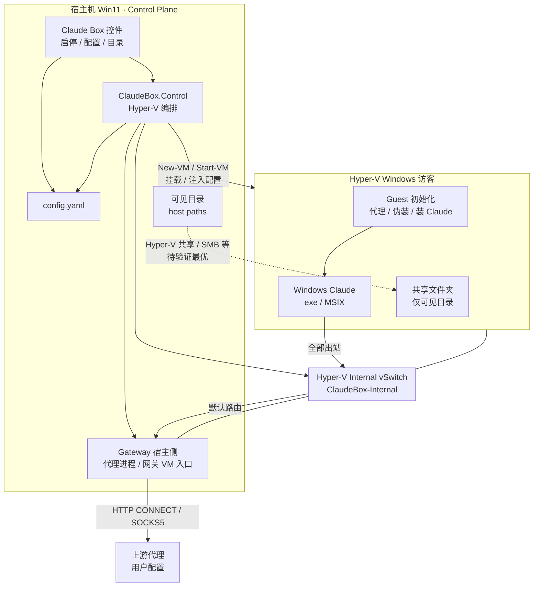

# Claude Box · 架构方案 v0

- **日期**：2026-10-31（Asia/Tokyo）
- **对应范围**：[SCOPE.md](../SCOPE.md) v0.1（主路径：Hyper-V Windows 访客 + Windows Claude）
- **依赖调研**：[research-v1-runtime.md](./research-v1-runtime.md)（尤其 §2.6 Hyper-V Win、§3 唯一网关）
- **性质**：产品架构与仓库骨架约定；标「待验证」处禁止当定论
- **不做**：本文件不声称已在 Hyper-V 上跑通；不 push 远程

---

## 1. 目标与非目标

### 1.1 目标（对齐 SCOPE）

| # | 目标 |
|---|---|
| T1 | 在 **隔离的 Windows 访客**里跑 **Windows Claude Desktop**（exe/MSIX），保留 Computer use 等完整能力 |
| T2 | **原生 GUI**：Enhanced Session / 访客桌面窗口透出到宿主机（非 Web 远程桌面作主 UX） |
| T3 | **唯一网关硬强制**：出站不能直连绕过；上游由控件配置 HTTP CONNECT 与/或 SOCKS5 |
| T4 | **目录可见性**：默认只挂控件指定的可见目录；全盘非默认 |
| T5 | **环境伪装 / 反遥测**：访客独立 TZ、locale、hostname 等；网关可拦分析域（字段级效果 **待验证**） |
| T6 | **独立控件**（MVP）：配网关、选目录、启停实例并透出窗口 |

### 1.2 非目标（MVP 不做）

| # | 非目标 |
|---|---|
| N1 | 多账号一键切换 |
| N2 | Linux 宿主机一等支持 |
| N3 | Web 远程桌面作主 UX |
| N4 | 自建 Hypervisor / OCI 运行时（借 Hyper-V） |
| N5 | WSL2 / Docker / Linux Claude 作主路径（无 Computer use） |
| N6 | Windows Sandbox 作产品运行时（仅冒烟） |
| N7 | macOS 一等实现（次优先，另议） |
| N8 | 保证「全盘可读仍藏宿主机时区」（默认走可见目录） |

---

## 2. 逻辑架构



### 数据流（出站）

1. Claude / 访客进程发起 TCP（及 DNS，策略见 §4）
2. 访客默认路由指向 Internal 网上的网关地址（非宿主机默认外网）
3. 网关做透明劫持或显式强制代理 → 转发到控件配置的上游 HTTP/SOCKS5
4. **验收**：关掉上游或误配时，访客内 `curl`/浏览器 **直连公网必须失败**

---

## 3. 组件职责

### 3.1 Control Plane（宿主机）· `src/ClaudeBox.Control`

| 职责 | 说明 |
|---|---|
| 读配置 | 加载 `config.yaml`，校验 schema |
| Hyper-V 生命周期 | 检查功能、创建/删除 Internal 交换机、创建/启动/停止/检查 VM |
| 挂载编排 | 把 `visible_dirs` 暴露进访客（机制 **待验证**：Enhanced Session 共享 / SMB / 其它） |
| 网关编排 | 启动/停止宿主侧网关进程或确保网关 VM 就绪；把上游地址写入网关配置 |
| 注入访客配置 | 把伪装参数、代理地址、目录列表交给 Guest 初始化（ISO/云初始化/启动脚本——**待验证**） |
| 透窗 | 触发 Enhanced Session / `vmconnect` 等（体验 **待验证**） |

**边界**：不实现透明代理协议栈本身；不在 Control 里装 Claude。

### 3.2 Gateway · `src/ClaudeBox.Gateway`

| 职责 | 说明 |
|---|---|
| 上游适配 | 消费 `gateway.http` / `gateway.socks5` |
| 强制策略说明与脚本 | iptables/Win 防火墙 / tun2socks / redsocks 等**占位与配置模板**；具体二进制选型 **待验证** |
| 健康检查钩子 | 「直连失败 / 代理出口 IP 正确」验收命令草案 |
| DNS/UDP 策略文档 | 见 §4；实现分阶段 |

**部署形态（二选一或组合，待验证）**：

- **A. 宿主机进程**：挂在 Internal 网 NIC 上，作默认网关
- **B. 专用轻量网关 VM**：同 Internal 交换机，访客只认它

MVP 优先尝试 **A**（少一台 VM）；若权限/路由不稳再评 **B**。

### 3.3 Guest Agent / 访客初始化 · `src/ClaudeBox.Guest`

| 职责 | 说明 |
|---|---|
| 首次初始化 | 设 hostname、时区、locale；装/更新强制代理组件 |
| 网络强制（访客内） | 系统代理 +（必要时）本地透明/强制工具；禁旁路 **待验证** Electron 是否吃系统代理 |
| 安装 Claude | 引导安装 Windows Claude（MSIX/exe）；不把安装包硬编码进仓库 |
| 目录挂载点 | 约定盘符或路径（如 `Z:\projects\...`）只读/读写策略 |
| 健康脚本 | 打印伪装字段、测代理、测直连失败 |

**边界**：Guest 脚本只在**访客内**跑；由 Control 负责「如何送进去、何时跑」。

### 3.4 Config schema · `config/`

单一真相：`config/schema/claude-box.schema.json` + 示例 `config/config.example.yaml`。  
控件与 CLI 都读同一结构（字段见 §7）。

---

## 4. 网络强制方案

### 4.1 拓扑

```
[访客 NIC] ── Internal vSwitch "ClaudeBox-Internal" ── [网关 NIC / 宿主 vEthernet]
     │                                                        │
     │  默认网关 = 网关地址（如 192.168.87.1）                    │ 上游 HTTP/SOCKS5
     │  无 External 交换机直连公网                               ▼
     │                                              [用户代理 / 直出由网关决定]
```

- 访客 **只** 接 Internal 交换机（禁止再挂 Default Switch / External 作旁路）。
- 宿主机上为该 Internal 网配置静态 IP（网关地址），并跑代理入口。
- NAT：若上游是「本机再出去」，由网关进程做；**不要**给访客开一条可直连的 Hyper-V Default NAT 而不经代理。

> Hyper-V NAT 官方文档可参考：[Hyper-V NAT](https://learn.microsoft.com/en-us/windows-server/virtualization/hyper-v/setup-nat-network)。Internal + 自建网关是调研推荐的硬强制形态（见 research-v1 §3）。

### 4.2 代理协议

| 控件配置 | 用途 |
|---|---|
| `gateway.http` | HTTP CONNECT 上游（`http://host:port`，可选用户名密码 **待验证** 存法） |
| `gateway.socks5` | SOCKS5 上游（`socks5://host:port`） |
| 同时配置时 | 优先级字段 `gateway.primary`：`http` \| `socks5`（默认 `http` 若两者皆有则 **待产品确认**；示例里显式写） |

访客侧：

1. **系统代理**指向网关提供的本地/内网入口（或网关本身即上游中继）
2. **硬强制**：访客防火墙 / 路由只允许到网关；或网关前透明劫持  
   → 仅设 `HTTP_PROXY` **不够**（Electron 可绕过）——验收必须「直连失败」

### 4.3 DNS / UDP / QUIC

| 流量 | MVP 策略 | 状态 |
|---|---|---|
| DNS | 访客 DNS 指到网关；或强制 DoH 经代理；禁明文 DNS 旁路 | **待验证** 最优 |
| UDP | 默认 DROP 或仅放行经 SOCKS5 UDP 关联（若上游支持） | **待验证** |
| QUIC/HTTP3 | 易绕过 TCP 代理；建议访客内禁用 QUIC 或 DROP UDP/443 | **待验证** Claude 是否强依赖 |

### 4.4 验收「直连失败」

在访客内（网关正常、上游可达时）：

1. 经代理访问 `https://api.ipify.org`（或同类）→ 出口 IP = 代理出口  
2. 临时阻断上游或清空系统代理且保持「仅 Internal」路由 → `curl https://1.1.1.1` / 公网应 **失败**  
3. 恢复后 Claude 登录/对话仍可用  

未满足 2 → **不得**宣称唯一网关已达成。

---

## 5. 目录挂载策略

| 策略 | 说明 |
|---|---|
| **默认** | 仅 `visible_dirs[]` 列表中的宿主机路径进入访客 |
| **全盘** | 非默认；控件需显式开启；开启后环境伪装（时区等）**基本不可靠**（SCOPE 已承认） |
| **禁止挂载** | 建议黑名单：`C:\Windows`、用户凭据目录、其它盒子的配置密钥路径等（细则 **待验证**） |
| **机制** | Enhanced Session 共享文件夹 / `Copy-VMFile` / 访客内 SMB 挂宿主只读共享——**待验证**选一作 M3 默认 |
| **权限** | 示例配置支持每条目 `read_only: true\|false`；MVP 可先全部读写再收紧 |

---

## 6. 环境伪装清单（访客内）

| 项 | 动作 | 状态 |
|---|---|---|
| hostname | 设为配置 `identity.hostname`（默认如 `claude-box`） | 脚本可做 |
| 时区 | `tzutil` / 设置 `identity.timezone`（如 `UTC`） | 脚本可做 |
| 系统区域 / 语言 | `identity.locale`（如 `en-US`） | 脚本可做；UI 语言是否影响 Claude **待验证** |
| 机器名 / 工作组 | 与 hostname 对齐 | 脚本可做 |
| machine guid / 硬件指纹 | 完整伪造难；VM 已有独立 SMBIOS | 能挡到什么程度 **待验证** |
| 不挂宿主身份文件 | 不把宿主 `C:\Users\...` 整盘映射进来 | 流程约束 |
| 网关拦遥测域 | Sentry/Datadog 等（企业 3P 文档有列；消费级 **待验证**） | M2+ |

---

## 7. 控件 MVP 能力与配置草案

### 7.1 控件 MVP 能力列表

1. 加载 / 校验配置文件  
2. 检查 Hyper-V / 管理员权限 / 虚拟化就绪  
3. 创建或复用 Internal 交换机  
4. 创建 / 启动 / 停止 / 销毁命名 VM  
5. 配置并应用网关上游（HTTP / SOCKS5）  
6. 配置可见目录列表并在启动时挂载  
7. 打开访客会话窗口（Enhanced Session / vmconnect）  
8. 显示简单状态：VM 状态、网关是否在听、上次错误  

（图形 UI 放 **M4**；M0–M3 以 PowerShell CLI 为主。）

### 7.2 配置文件草案（YAML）

见仓库：`config/config.example.yaml`、`config/schema/claude-box.schema.json`。

**字段表**：

| 字段 | 类型 | 必填 | 说明 |
|---|---|---|---|
| `apiVersion` | string | 是 | 固定 `claude-box/v1alpha1` |
| `kind` | string | 是 | 固定 `Box` |
| `metadata.name` | string | 是 | 逻辑名 |
| `spec.vm.name` | string | 是 | Hyper-V VM 名 |
| `spec.vm.memory_mb` | int | 是 | 内存 MiB（建议 ≥ 4096，**待验证** Claude 最低） |
| `spec.vm.cpus` | int | 否 | 默认 2 |
| `spec.vm.generation` | 1\|2 | 否 | 默认 2 |
| `spec.vm.vhd_path` | string | 否 | VHDX 路径；空则由控件按约定生成 |
| `spec.vm.switch_name` | string | 否 | 默认 `ClaudeBox-Internal` |
| `spec.gateway.primary` | `http`\|`socks5` | 否 | 双配时优先 |
| `spec.gateway.http` | string | 条件 | `http://host:port` |
| `spec.gateway.socks5` | string | 条件 | `socks5://host:port` |
| `spec.gateway.listen_ip` | string | 否 | Internal 网上网关 IP，默认 `192.168.87.1` |
| `spec.gateway.subnet` | string | 否 | 默认 `192.168.87.0/24` |
| `spec.visible_dirs[]` | object | 否 | `host_path`, `read_only` |
| `spec.identity.hostname` | string | 否 | 默认 `claude-box` |
| `spec.identity.timezone` | string | 否 | 默认 `UTC` |
| `spec.identity.locale` | string | 否 | 默认 `en-US` |
| `spec.features.full_disk` | bool | 否 | 默认 `false`；true 时警告伪装失效 |

约束：`gateway.http` 与 `gateway.socks5` **至少一个**非空（MVP 强制网关）。

---

## 8. 仓库目录约定与模块边界

```
Claude-Box/
  SCOPE.md
  README.md
  docs/
    research-v0.md
    research-v1-runtime.md
    architecture-v0.md          ← 本文件
  config/
    config.example.yaml
    schema/claude-box.schema.json
  src/
    ClaudeBox.Control/          # 宿主机：VM / 交换机 / 配置
    ClaudeBox.Gateway/          # 网关模板、说明、宿主侧脚本占位
    ClaudeBox.Guest/            # 访客内初始化（在访客 Windows 上执行）
  scripts/win11/                # 一键检查、创建交换机等入口脚本
  tests/                        # 语法/结构检查；Hyper-V 集成测试仅在 Win11 跑
```

| 模块 | 可依赖 | 不可依赖 |
|---|---|---|
| Control | 配置 schema、Gateway **配置接口** | Guest 内 Claude 安装细节硬编码 |
| Gateway | 配置中的 gateway 段 | Hyper-V cmdlet（保持可迁网关 VM） |
| Guest | 配置中的 identity / gateway 入口地址 | 宿主机路径、Hyper-V API |
| scripts/win11 | 调用 Control 导出函数 | 业务逻辑散落在脚本里（脚本应薄） |

语言：**PowerShell 5.1+ / 7+**（Hyper-V 模块在 Win11）；本 Linux box 仅做文件与语法检查，**不**假装已跑通 Hyper-V。

---

## 9. 分阶段里程碑

| 阶段 | 目标 | 完成判据 |
|---|---|---|
| **M0 骨架** | 仓库目录、配置 schema、Control/Gateway/Guest 占位、文档 | 本提交；Linux 上结构检查通过 |
| **M1 空访客** | Win11 上能 New-VM + 接 Internal 交换机 + Start-VM + 进桌面 | 无 Claude；可手工装系统 |
| **M2 网关硬强制** | 访客出站经网关；直连失败验收通过 | 有抓包或 curl 记录 |
| **M3 Claude + 目录** | 访客内 Windows Claude 可登录对话；可见目录可用；伪装脚本跑通 | Computer use **待验证**是否在 VM 内正常 |
| **M4 控件 UI 最小** | 简单 GUI 或完善 CLI：配代理、选目录、一键启停透窗 | 对齐 SCOPE 控件三条 |

---

## 10. 风险与待验证

| ID | 项 | 影响 | 缓解 |
|---|---|---|---|
| R1 | Enhanced Session 观感不像「应用窗口」 | UX 落差 | 和零确认；M1 先看窗口形态 |
| R2 | 访客内 Electron 绕过系统代理 | 假网关 | 透明/路由硬强制；验收直连失败 |
| R3 | QUIC/UDP 旁路 | 泄漏 | DROP UDP 或禁 HTTP3；**待验证** |
| R4 | 共享文件夹机制与凭据 | 目录隔离失败 | M3 尖兵对比几种挂载 |
| R5 | Computer use 在 Hyper-V 内异常 | 主因失效 | M3 专项验证；记录 GPU/输入限制 |
| R6 | 镜像大、启动慢、激活/更新 | 产品体验 | 差分磁盘；模板 VM；文档预期 |
| R7 | 消费级遥测域不全 | 反遥测不完整 | 网关可配置 blocklist；不承诺字段级 |
| R8 | 嵌套虚拟化 / 宿主无 HV | 无法创建 VM | scripts 预检；文档要求 |
| R9 | macOS 无对等 Win 访客 | 次平台 | SCOPE 已降级 |

---

## 11. Win11 最小验证清单（可执行）

在启用 Hyper-V 的 Windows 11 上，按序执行；结果建议记入 `docs/research-v1-experiments.md`（另开，非本提交强制）。

1. **HV-1 · 功能预检**  
   管理员 PowerShell：`Get-WindowsOptionalFeature -Online -FeatureName Microsoft-Hyper-V-All`；确认 `Hyper-V` 相关为 Enabled；`systeminfo` 看虚拟化已启用。

2. **HV-2 · 建 Internal 交换机**  
   `New-VMSwitch -SwitchName ClaudeBox-Internal -SwitchType Internal`；为 `vEthernet (ClaudeBox-Internal)` 设静态 IP（如 `192.168.87.1/24`）。

3. **HV-3 · 空访客**  
   用已有 Win11/Win10 评估镜像或官方 ISO 创建 Gen2 VM，**只**挂 `ClaudeBox-Internal`，分配内存 ≥ 4GB；`Start-VM`；Enhanced Session 进桌面。记录启动耗时与窗口观感。

4. **HV-4 · 无旁路**  
   访客内确认只有该网卡；尝试访问公网应失败（尚未接网关时）或仅能访问 Internal 网关 IP——记下基线。

5. **HV-5 · 网关尖兵**  
   宿主机在 `192.168.87.1` 跑最小 HTTP 或 SOCKS5 中继（工具选型 **待验证**）；访客默认路由指到 `.1`；经代理 `curl` 通；断上游后直连失败。

6. **HV-6 · 系统代理 + 浏览器**  
   访客设系统代理后 Edge 访问公网；关代理且保持路由限制应失败。

7. **HV-7 · 装 Windows Claude**  
   在访客内安装官方 Windows Claude；登录并完成一轮对话；记录是否提示虚拟机/环境异常。

8. **HV-8 · Computer use 抽测**  
   若账号具备该能力：在访客内试一次 Computer use；记录成/败与输入、分辨率问题。

9. **HV-9 · 可见目录**  
   任选一种共享方式挂入单一项目目录；确认读得到该目录、读不到未共享的宿主用户文件。

10. **HV-10 · 伪装抽测**  
    改访客 hostname/时区/locale 后，在访客内查看系统设置与 `Get-TimeZone`；确认与宿主不一致。

**建议顺序**：HV-1 → HV-3 对应 **M1**；HV-4→HV-6 对应 **M2**；HV-7→HV-10 对应 **M3**。

---

## 12. 一句话摘要

**Claude Box v0 = 宿主机 PowerShell 控件编排 Hyper-V Windows 访客跑 Windows Claude，Internal 交换机把出站硬拐进可配 HTTP/SOCKS5 唯一网关，默认只挂可见目录并做访客级环境伪装。**
